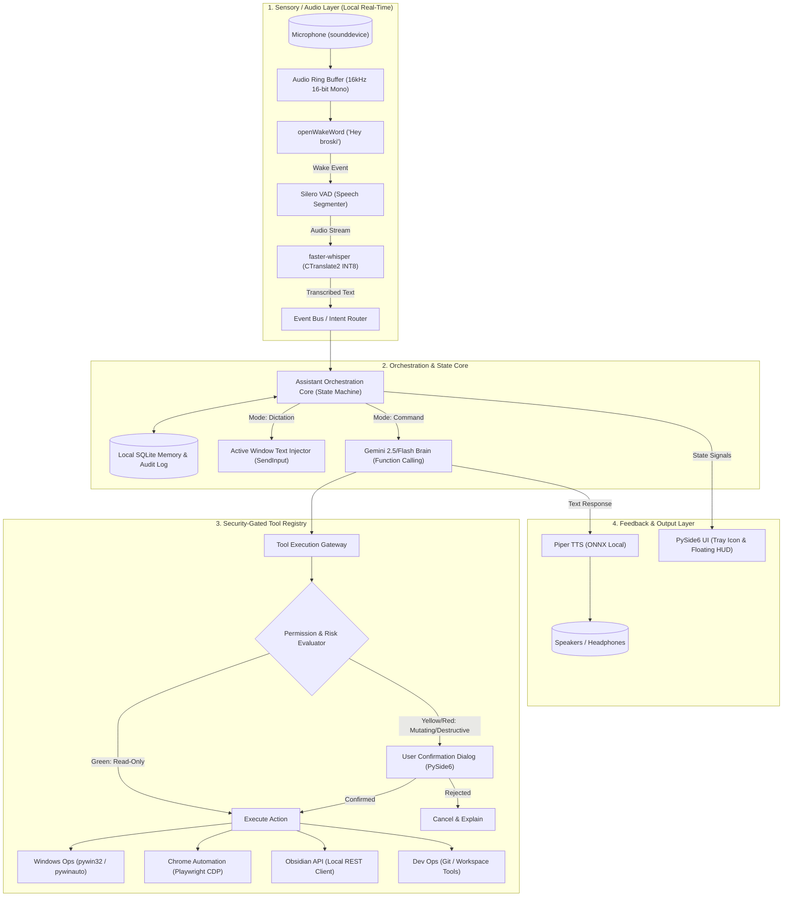
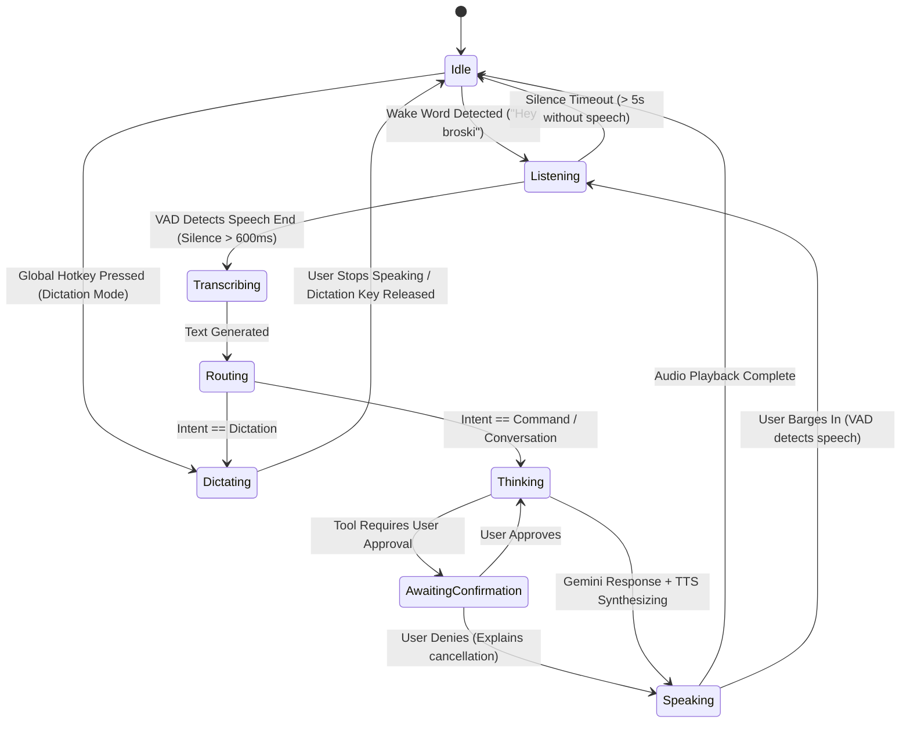

# System Architecture & Technical Specification: broski
**Personal Windows AI Voice Assistant**

---

## 1. Executive Summary & Hardware Context

**broski** is an asynchronous, modular, and privacy-conscious AI voice assistant engineered specifically for Windows 11. It bridges local, CPU-optimized sensory processing (Wake Word, VAD, STT, TTS) with cloud reasoning (Google Gemini API) to provide sub-second conversational voice interaction, active-window text injection, application control, and development assistance.

### Hardware Envelope & Performance Budget
* **CPU**: Intel Core i7-1165G7 (4 cores / 8 physical threads; Tiger Lake architecture; base clock 2.80 GHz, boost up to 4.70 GHz).
* **RAM**: 16 GB DDR4/LPDDR4x.
* **GPU**: Intel Iris Xe Integrated Graphics (96 EUs; Shared System Memory; no dedicated VRAM/CUDA).
* **OS**: Windows 11 Pro/Home (Build 26300+ detected).
* **Thermal Envelope**: 15W–28W cTDP. Prolonged continuous multi-threaded load triggers thermal downclocking. Local inference must therefore be event-driven, chunk-based, and quantization-optimized (`int8` / ONNX CPU EP).

```
+---------------------------------------------------------------------------------------------------+
|                                  HARDWARE RESOURCE ALLOCATION                                     |
+------------------------------------+--------------------------------------------------------------+
| Component                          | Target Resource Footprint                                    |
+------------------------------------+--------------------------------------------------------------+
| openWakeWord (ONNX CPU)            | < 1.5% CPU continuous (single thread, 80ms audio frames)     |
| Silero VAD v4 (ONNX CPU)           | < 2.0% CPU continuous (single thread, 30ms-50ms frames)      |
| faster-whisper (CTranslate2 INT8)  | 2-3 cores burst during speech (~200ms per 3s utterance)      |
| Piper TTS (ONNX CPU)               | 1-2 cores burst (~150ms latency to first audio chunk)        |
| PySide6 GUI / System Tray / HUD    | < 80 MB RAM, idle 0% CPU (hardware-accelerated via D3D11)    |
| Total Idle Footprint               | < 350 MB RAM, < 3.5% total CPU load                          |
+------------------------------------+--------------------------------------------------------------+
```

---

## 2. High-Level Architecture & Component Design

The architecture is built around an **Asynchronous Event-Driven Micro-Kernel** with an **Intent Router & Tool Gateway**. Components communicate via asynchronous message buses (`asyncio.Queue`) and Qt Signals for UI decoupling.



### 2.1 State Machine Design
The assistant operates under a deterministic state machine:



---

## 3. Security Architecture & Command Sandboxing

To adhere to the core engineering principle (**"No unrestricted LLM-generated terminal execution"**):
1. **Categorized Tool Risk Levels**:
   - `SAFE` (Read-only): Window title lookup, note reading, time check, git status, search queries. Automatically allowed.
   - `MODERATE` (Non-destructive mutation): App launching, daily note appending, clipboard copy, volume adjustment. Logged and allowed with brief audio acknowledgment.
   - `CRITICAL` (Destructive / System): File deletion, git push/commit, running shell commands, killing processes, browser form submission. **Strictly requires explicit GUI or voice confirmation** before execution.
2. **Whitelist Parameter Validation**:
   - Shell commands are never passed directly to `subprocess.run(shell=True)`.
   - A dedicated `ToolRegistry` exposes typed Pydantic models for every action.

---

## 4. Dependencies & Technical Compatibility Matrix

* **Python 3.12 Virtual Environment Required**: `ctranslate2` and `onnxruntime` wheels on Windows are fully compatible with Python 3.12, avoiding missing pre-compiled wheel issues found on Python 3.13.
* **Core Libraries**:
  - `sounddevice` (Audio I/O)
  - `openwakeword` (Wake word engine)
  - `onnxruntime` (Silero VAD execution)
  - `faster-whisper` (CTranslate2 INT8 speech-to-text)
  - `piper-tts` (Fast local neural voice)
  - `google-genai` (Official modern Google GenAI SDK)
  - `aiosqlite` (Async local SQLite storage)
  - `PySide6` (Qt6 UI / HUD / Tray)
  - `pywin32` / `pywinauto` (Windows accessibility and text injection)
  - `playwright` (Chrome DevTools automation)
  - `httpx` (Obsidian REST API client)
